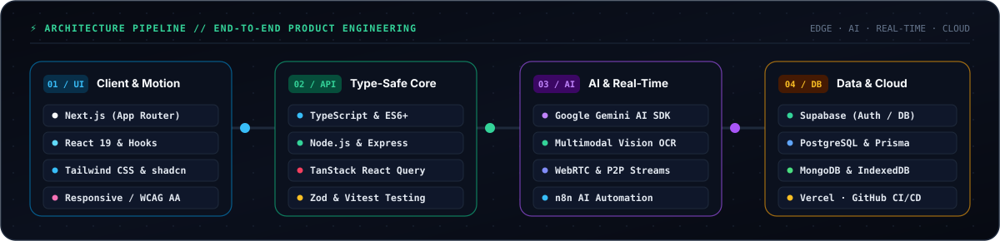

<div align="center">

<!-- ================= HERO COMMAND CENTER BANNER ================= -->
<a href="https://hamzaisadev.netlify.app">
  
</a>

<br />
<br />

<!-- ================= UNIFIED NAVIGATION & SOCIAL DOCK ================= -->
<p align="center">
  <a href="https://hamzaisadev.netlify.app">
    
  </a>
  <a href="https://www.linkedin.com/in/hamzaisadev/">
    
  </a>
  <a href="https://twitter.com/hamzaisadev">
    
  </a>
  <a href="https://youtube.com/channel/UCPR0FgOTackPp82nMyPqf5A">
    
  </a>
  <a href="mailto:hamzaisadev@gmail.com">
    
  </a>
</p>

<p align="center">
  <a href="https://github.com/Hamzaisadev?tab=followers">
    
  </a>
  &nbsp;
  <a href="https://github.com/Hamzaisadev?tab=repositories&sort=stargazers">
    
  </a>
  &nbsp;
  <a href="https://github.com/Hamzaisadev">
    
  </a>
</p>


</div>

<!-- ================= TERMINAL & CAPABILITY TELEMETRY ================= -->
<div align="center">
  
</div>

<br />

<div align="center">
  
</div>

<!-- ================= FLAGSHIP BENTO GRID: SHIPPED PRODUCTS ================= -->
<h2 align="center">🚀 Flagship Products &amp; Systems</h2>
<p align="center">
  <sub>Production-grade full-stack applications, AI clinical systems, and real-time developer utilities engineered from the ground up.</sub>
</p>

<table align="center" width="100%">
  <tr>
    <td width="50%" align="center" valign="top">
      <a href="https://curewell-gamma.vercel.app">
        
      </a>
      <p align="center">
        <a href="https://curewell-gamma.vercel.app"><b>🟢 Live Application ↗</b></a>
        &nbsp;·&nbsp;
        <a href="https://github.com/Hamzaisadev/Curewell"><b>📦 Source Code ↗</b></a>
      </p>
    </td>
    <td width="50%" align="center" valign="top">
      <a href="https://stash-ed.vercel.app">
        
      </a>
      <p align="center">
        <a href="https://stash-ed.vercel.app"><b>⚡ Live Application ↗</b></a>
        &nbsp;·&nbsp;
        <a href="https://github.com/Hamzaisadev/Stash"><b>📦 Source Code ↗</b></a>
      </p>
    </td>
  </tr>
  <tr>
    <td width="50%" align="center" valign="top">
      <a href="https://gadi-ghar.vercel.app">
        
      </a>
      <p align="center">
        <a href="https://gadi-ghar.vercel.app"><b>🚗 Live Marketplace ↗</b></a>
        &nbsp;·&nbsp;
        <a href="https://github.com/Hamzaisadev/gadi-ghar"><b>📦 Source Code ↗</b></a>
      </p>
    </td>
    <td width="50%" align="center" valign="top">
      <a href="https://snapistan.vercel.app">
        
      </a>
      <p align="center">
        <a href="https://snapistan.vercel.app"><b>💬 Live Platform ↗</b></a>
        &nbsp;·&nbsp;
        <a href="https://github.com/Hamzaisadev/Snapistan"><b>📦 Source Code ↗</b></a>
      </p>
    </td>
  </tr>
  <tr>
    <td width="50%" align="center" valign="top">
      <a href="https://github.com/Hamzaisadev/DevShot">
        
      </a>
      <p align="center">
        <a href="https://github.com/Hamzaisadev/DevShot"><b>📸 Extension &amp; Docs ↗</b></a>
        &nbsp;·&nbsp;
        <a href="https://codeload.github.com/Hamzaisadev/DevShot/zip/refs/heads/main"><b>⬇️ Download Preview ↗</b></a>
      </p>
    </td>
    <td width="50%" align="center" valign="top">
      <a href="https://linkwhize.netlify.app/">
        
      </a>
      <p align="center">
        <a href="https://linkwhize.netlify.app/"><b>🔗 Live Service ↗</b></a>
        &nbsp;·&nbsp;
        <a href="https://github.com/Hamzaisadev/LinkWhiz"><b>📦 Source Code ↗</b></a>
      </p>
    </td>
  </tr>
</table>

<details>
  <summary align="center"><b>📂 Explore More Shipped Projects &amp; Open-Source Tools (Click to Expand)</b></summary>
  <br />
  <table width="100%">
    <thead>
      <tr>
        <th align="left">Project</th>
        <th align="left">What It Solves</th>
        <th align="left">Core Stack</th>
        <th align="left">Links</th>
      </tr>
    </thead>
    <tbody>
      <tr>
        <td><b>💰 PennyWise</b></td>
        <td>Personal budgeting &amp; cash-flow tracking application with visual expense breakdowns.</td>
        <td><code>React</code> · <code>React Router</code> · <code>JavaScript</code></td>
        <td><a href="https://pennywisse.netlify.app/">Live Demo</a> · <a href="https://github.com/Hamzaisadev/PennyWise">Repo</a></td>
      </tr>
      <tr>
        <td><b>🎬 Vidiyo</b></td>
        <td>Responsive video discovery, streaming, and sharing web platform.</td>
        <td><code>React</code> · <code>REST APIs</code> · <code>CSS3</code></td>
        <td><a href="https://vidiyoo.netlify.app">Live Demo</a> · <a href="https://github.com/Hamzaisadev/Vidiyo">Repo</a></td>
      </tr>
      <tr>
        <td><b>🖼️ SmartPress Optimizer</b></td>
        <td>Automated WordPress image compression and next-gen format optimization plugin.</td>
        <td><code>PHP</code> · <code>WordPress API</code></td>
        <td><a href="https://github.com/Hamzaisadev/smartpress-image-optimizer">Repo</a></td>
      </tr>
      <tr>
        <td><b>🤖 Sabrina AI Assistant</b></td>
        <td>Conversational AI assistant interface with natural language task execution.</td>
        <td><code>JavaScript</code> · <code>AI APIs</code></td>
        <td><a href="https://github.com/Hamzaisadev/Sabrina-Ai-Assistant">Repo</a></td>
      </tr>
      <tr>
        <td><b>⚡ JavaScript Lab</b></td>
        <td>Curated collection of interactive vanilla JavaScript micro-apps and DOM experiments.</td>
        <td><code>HTML5</code> · <code>CSS3</code> · <code>ES6+</code></td>
        <td><a href="https://hamzaisadev.github.io/Java-Script-Projects/">Live Lab</a> · <a href="https://github.com/Hamzaisadev/Java-Script-Projects">Repo</a></td>
      </tr>
    </tbody>
  </table>
</details>

<br />

<div align="center">
  
</div>

<!-- ================= ARCHITECTURE & TECH STACK PIPELINE ================= -->
<h2 align="center">🛠️ Architecture &amp; Technical Ecosystem</h2>
<p align="center">
  <sub>How I design, build, test, and deploy resilient software from browser edge to cloud database.</sub>
</p>

<div align="center">
  
</div>

<br />

<div align="center">
  <p>
    
    
    
    
    
    
    
  </p>
  <p>
    
    
    
    
    
    
    
  </p>
</div>

<br />

<div align="center">
  
</div>

<!-- ================= LIVE ACTIVITY & TELEMETRY ================= -->
<h2 align="center">📈 Activity &amp; Engineering Pulse</h2>

<div align="center">
  <a href="https://git.io/streak-stats">
    
  </a>
</div>

<br />

<details>
  <summary align="center"><b>📊 View Automated WakaTime &amp; Repository Telemetry (Updated Daily via GitHub Actions)</b></summary>
  <br />

<!--START_SECTION:waka-->


**🐱 My GitHub Data** 

> 📦 358.7 kB Used in GitHub's Storage 
 > 
> 🏆 85 Contributions in the Year 2026
 > 
> 🚫 Not Opted to Hire
 > 
> 📜 36 Public Repositories 
 > 
> 🔑 11 Private Repositories 
 > 
**I'm a Night 🦉** 

```text
🌞 Morning                56 commits          █░░░░░░░░░░░░░░░░░░░░░░░░   05.57 % 
🌆 Daytime                325 commits         ████████░░░░░░░░░░░░░░░░░   32.31 % 
🌃 Evening                431 commits         ███████████░░░░░░░░░░░░░░   42.84 % 
🌙 Night                  194 commits         █████░░░░░░░░░░░░░░░░░░░░   19.28 % 
```
📅 **I'm Most Productive on Wednesday** 

```text
Monday                   92 commits          ██░░░░░░░░░░░░░░░░░░░░░░░   09.15 % 
Tuesday                  64 commits          ██░░░░░░░░░░░░░░░░░░░░░░░   06.36 % 
Wednesday                265 commits         ███████░░░░░░░░░░░░░░░░░░   26.34 % 
Thursday                 108 commits         ███░░░░░░░░░░░░░░░░░░░░░░   10.74 % 
Friday                   152 commits         ████░░░░░░░░░░░░░░░░░░░░░   15.11 % 
Saturday                 178 commits         ████░░░░░░░░░░░░░░░░░░░░░   17.69 % 
Sunday                   147 commits         ████░░░░░░░░░░░░░░░░░░░░░   14.61 % 
```


📊 **This Week I Spent My Time On** 

```text
🕑︎ Time Zone: Asia/Karachi

💬 Programming Languages: 
No Activity Tracked This Week

🔥 Editors: 
No Activity Tracked This Week

🐱‍💻 Projects: 
No Activity Tracked This Week

💻 Operating System: 
No Activity Tracked This Week
```

🤖 **AI Coding This Week** 

```text
No AI Coding Activity Tracked This Week
```

**I Mostly Code in JavaScript** 

```text
JavaScript               20 repos            ████████████░░░░░░░░░░░░░   46.51 % 
Python                   7 repos             ████░░░░░░░░░░░░░░░░░░░░░   16.28 % 
TypeScript               4 repos             ██░░░░░░░░░░░░░░░░░░░░░░░   09.30 % 
C                        2 repos             █░░░░░░░░░░░░░░░░░░░░░░░░   04.65 % 
PHP                      1 repo              █░░░░░░░░░░░░░░░░░░░░░░░░   02.33 % 
```


**Timeline**


 Last Updated on 16/10/2026 02:21:47 UTC
<!--END_SECTION:waka-->

</details>

<br />

<!-- ================= ANIMATED FOOTER BANNER ================= -->
<div align="center">
  <a href="https://hamzaisadev.netlify.app">
    
  </a>
</div>
