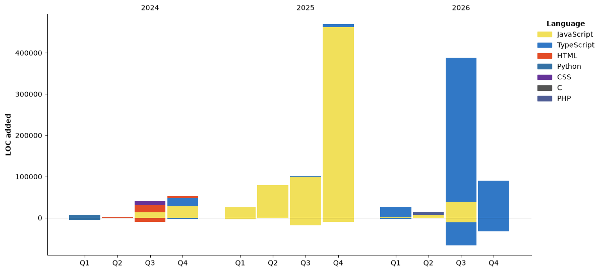

<div align="center">

<!-- ================= HERO COMMAND CENTER BANNER ================= -->
<a href="https://hamzaisadev.netlify.app">
  
</a>

<br />
<br />

<!-- ================= UNIFIED NAVIGATION & SOCIAL DOCK ================= -->
<p align="center">
  <a href="https://hamzaisadev.netlify.app">
    
  </a>
  <a href="https://www.linkedin.com/in/hamzaisadev/">
    
  </a>
  <a href="https://twitter.com/hamzaisadev">
    
  </a>
  <a href="https://youtube.com/channel/UCPR0FgOTackPp82nMyPqf5A">
    
  </a>
  <a href="mailto:hamzaisadev@gmail.com">
    
  </a>
</p>

<p align="center">
  <a href="https://github.com/Hamzaisadev?tab=followers">
    
  </a>
  &nbsp;
  <a href="https://github.com/Hamzaisadev?tab=repositories&sort=stargazers">
    
  </a>
  &nbsp;
  <a href="https://github.com/Hamzaisadev">
    
  </a>
</p>

<p align="center">
  <b>Founder, Albatix — I build production web apps and e-commerce that solve a business problem.</b><br />
  <sub>Full-stack developer in Karachi, Pakistan. Available for freelance web development and for front-end roles, Karachi / remote, React, Next.js, TypeScript.</sub>
</p>

<p align="center">
  <sub>How I work: measured by whether the product brings more customers, sales, or profit, not by how much code I write. Technical understanding still matters, to direct, evaluate, and debug AI output.</sub>
</p>


</div>

<!-- ================= TERMINAL & CAPABILITY TELEMETRY ================= -->
<div align="center">
  
</div>

<br />

<div align="center">
  
</div>

<!-- ================= CURRENTLY ================= -->
<h2 align="center">🎯 Currently</h2>
<p align="center">
  <sub>What I am building and what I am open to, right now.</sub>
</p>

- 🔨 Building full-stack web apps and e-commerce with Next.js, React, TypeScript, Tailwind, Prisma, PostgreSQL, Supabase, and MongoDB
- 🏥 Curewell — personal health OS with medication scheduling, lab tracking, prescription OCR, and AI clinical insights. Bano Qabil x Alibaba Cloud AI Hackathon national finalist, Islamabad, Oct 24, 2026
- 🏢 Founder, Albatix — freelance web development for businesses that need a site that sells, not just a site that exists
- 💼 Open to front-end roles — Karachi / remote, React, Next.js, TypeScript, Tailwind. CV and portfolio on request
- 📬 Fastest contact: hamzaisadev@gmail.com — tell me your business goal, pages you need, and a rough budget range, and I will reply with a scoped plan

<br />

<div align="center">
  
</div>

<!-- ================= FLAGSHIP BENTO GRID: SHIPPED PRODUCTS ================= -->
<h2 align="center">🚀 Flagship Products & Systems</h2>
<p align="center">
  <sub>Production-grade full-stack applications, AI clinical systems, and real-time developer utilities engineered from the ground up.</sub>
</p>

<table align="center" width="100%">
  <tr>
    <td width="50%" align="center" valign="top">
      <a href="https://curewell-gamma.vercel.app">
        
      </a>
      <p align="center">
        <a href="https://curewell-gamma.vercel.app"><b>🟢 Live Application ↗</b></a>
        &nbsp;·&nbsp;
        <a href="https://github.com/Hamzaisadev/Curewell"><b>📦 Source Code ↗</b></a>
      </p>
    </td>
    <td width="50%" align="center" valign="top">
      <a href="https://stash-ed.vercel.app">
        
      </a>
      <p align="center">
        <a href="https://stash-ed.vercel.app"><b>⚡ Live Application ↗</b></a>
        &nbsp;·&nbsp;
        <a href="https://github.com/Hamzaisadev/Stash"><b>📦 Source Code ↗</b></a>
      </p>
    </td>
  </tr>
  <tr>
    <td width="50%" align="center" valign="top">
      <a href="https://gadi-ghar.vercel.app">
        
      </a>
      <p align="center">
        <a href="https://gadi-ghar.vercel.app"><b>🚗 Live Marketplace ↗</b></a>
        &nbsp;·&nbsp;
        <a href="https://github.com/Hamzaisadev/gadi-ghar"><b>📦 Source Code ↗</b></a>
      </p>
    </td>
    <td width="50%" align="center" valign="top">
      <a href="https://snapistan.vercel.app">
        
      </a>
      <p align="center">
        <a href="https://snapistan.vercel.app"><b>💬 Live Platform ↗</b></a>
        &nbsp;·&nbsp;
        <a href="https://github.com/Hamzaisadev/Snapistan"><b>📦 Source Code ↗</b></a>
      </p>
    </td>
  </tr>
  <tr>
    <td width="50%" align="center" valign="top">
      <a href="https://github.com/Hamzaisadev/DevShot">
        
      </a>
      <p align="center">
        <a href="https://github.com/Hamzaisadev/DevShot"><b>📸 Extension & Docs ↗</b></a>
        &nbsp;·&nbsp;
        <a href="https://codeload.github.com/Hamzaisadev/DevShot/zip/refs/heads/main"><b>⬇️ Download Preview ↗</b></a>
      </p>
    </td>
    <td width="50%" align="center" valign="top">
      <a href="https://linkwhize.netlify.app/">
        
      </a>
      <p align="center">
        <a href="https://linkwhize.netlify.app/"><b>🔗 Live Service ↗</b></a>
        &nbsp;·&nbsp;
        <a href="https://github.com/Hamzaisadev/LinkWhiz"><b>📦 Source Code ↗</b></a>
      </p>
    </td>
  </tr>
</table>

<details>
  <summary align="center"><b>📂 Explore More Shipped Projects & Open-Source Tools (Click to Expand)</b></summary>
  <br />
  <table width="100%">
    <thead>
      <tr>
        <th align="left">Project</th>
        <th align="left">What It Solves</th>
        <th align="left">Core Stack</th>
        <th align="left">Links</th>
      </tr>
    </thead>
    <tbody>
      <tr>
        <td><b>🏛️ Daily Dev Vault</b></td>
        <td>Automated daily engineering vault: production-grade distributed systems, architecture deep dives & high-performance patterns.</td>
        <td><code>Python</code> · <code>TypeScript</code> · <code>GitHub Actions</code></td>
        <td><a href="https://github.com/Hamzaisadev/daily-dev-vault"><b>Explore Vault & Star ⭐</b></a></td>
      </tr>
      <tr>
        <td><b>💰 PennyWise</b></td>
        <td>Personal budgeting & cash-flow tracking application with visual expense breakdowns.</td>
        <td><code>React</code> · <code>React Router</code> · <code>JavaScript</code></td>
        <td><a href="https://pennywisse.netlify.app/">Live Demo</a> · <a href="https://github.com/Hamzaisadev/PennyWise">Repo</a></td>
      </tr>
      <tr>
        <td><b>🎬 Vidiyo</b></td>
        <td>Responsive video discovery, streaming, and sharing web platform.</td>
        <td><code>React</code> · <code>REST APIs</code> · <code>CSS3</code></td>
        <td><a href="https://vidiyoo.netlify.app">Live Demo</a> · <a href="https://github.com/Hamzaisadev/Vidiyo">Repo</a></td>
      </tr>
      <tr>
        <td><b>🖼️ SmartPress Optimizer</b></td>
        <td>Automated WordPress image compression and next-gen format optimization plugin.</td>
        <td><code>PHP</code> · <code>WordPress API</code></td>
        <td><a href="https://github.com/Hamzaisadev/smartpress-image-optimizer">Repo</a></td>
      </tr>
      <tr>
        <td><b>🤖 Sabrina AI Assistant</b></td>
        <td>Conversational AI assistant interface with natural language task execution.</td>
        <td><code>JavaScript</code> · <code>AI APIs</code></td>
        <td><a href="https://github.com/Hamzaisadev/Sabrina-Ai-Assistant">Repo</a></td>
      </tr>
      <tr>
        <td><b>⚡ JavaScript Lab</b></td>
        <td>Curated collection of interactive vanilla JavaScript micro-apps and DOM experiments.</td>
        <td><code>HTML5</code> · <code>CSS3</code> · <code>ES6+</code></td>
        <td><a href="https://hamzaisadev.github.io/Java-Script-Projects/">Live Lab</a> · <a href="https://github.com/Hamzaisadev/Java-Script-Projects">Repo</a></td>
      </tr>
      <tr>
        <td><b>👕 Riwayat</b></td>
        <td>Men's traditional clothing e-commerce.</td>
        <td><code>Next.js</code> · <code>React</code> · <code>Tailwind</code></td>
        <td><a href="https://hamzaisadev.netlify.app">Portfolio</a></td>
      </tr>
      <tr>
        <td><b>👟 Shoeaholic</b></td>
        <td>Footwear e-commerce, product structure and SEO.</td>
        <td><code>Next.js</code> · <code>React</code></td>
        <td><a href="https://hamzaisadev.netlify.app">Portfolio</a></td>
      </tr>
    </tbody>
  </table>
</details>

<br />

<div align="center">
  
</div>

<!-- ================= ARCHITECTURE & TECH STACK PIPELINE ================= -->
<h2 align="center">🛠️ Architecture & Technical Ecosystem</h2>
<p align="center">
  <sub>How I design, build, test, and deploy resilient software from browser edge to cloud database.</sub>
</p>

<div align="center">
  
</div>

<br />

<div align="center">
  <p>
    
    
    
    
    
    
    
  </p>
  <p>
    
    
    
    
    
    
    
  </p>
</div>

<br />

<div align="center">
  
</div>

<!-- ================= LIVE ACTIVITY & TELEMETRY ================= -->
<h2 align="center">📈 Activity & Engineering Pulse</h2>

<div align="center">
  <a href="https://git.io/streak-stats">
    
  </a>
</div>

<br />

<details>
  <summary align="center"><b>📊 View Automated WakaTime & Repository Telemetry (Updated Daily via GitHub Actions)</b></summary>
  <br />

<!--START_SECTION:waka-->


**🐱 My GitHub Data** 

> 📦 402.0 kB Used in GitHub's Storage 
 > 
> 🏆 230 Contributions in the Year 2026
 > 
> 🚫 Not Opted to Hire
 > 
> 📜 42 Public Repositories 
 > 
> 🔑 11 Private Repositories 
 > 
**I'm an Early 🐤** 

```text
🌞 Morning                912 commits         █████████░░░░░░░░░░░░░░░░   36.89 % 
🌆 Daytime                656 commits         ███████░░░░░░░░░░░░░░░░░░   26.54 % 
🌃 Evening                560 commits         ██████░░░░░░░░░░░░░░░░░░░   22.65 % 
🌙 Night                  344 commits         ███░░░░░░░░░░░░░░░░░░░░░░   13.92 % 
```
📅 **I'm Most Productive on Thursday** 

```text
Monday                   93 commits          █░░░░░░░░░░░░░░░░░░░░░░░░   03.76 % 
Tuesday                  68 commits          █░░░░░░░░░░░░░░░░░░░░░░░░   02.75 % 
Wednesday                272 commits         ███░░░░░░░░░░░░░░░░░░░░░░   11.00 % 
Thursday                 1173 commits        ████████████░░░░░░░░░░░░░   47.45 % 
Friday                   535 commits         █████░░░░░░░░░░░░░░░░░░░░   21.64 % 
Saturday                 184 commits         ██░░░░░░░░░░░░░░░░░░░░░░░   07.44 % 
Sunday                   147 commits         █░░░░░░░░░░░░░░░░░░░░░░░░   05.95 % 
```


📊 **This Week I Spent My Time On** 

```text
🕑︎ Time Zone: Asia/Karachi

💬 Programming Languages: 
TypeScript               1 hr 40 mins        ██████████████░░░░░░░░░░░   55.35 % 
Other                    1 hr 1 min          ████████░░░░░░░░░░░░░░░░░   33.84 % 
JavaScript               9 mins              █░░░░░░░░░░░░░░░░░░░░░░░░   05.30 % 
Markdown                 8 mins              █░░░░░░░░░░░░░░░░░░░░░░░░   04.50 % 
SQL                      1 min               ░░░░░░░░░░░░░░░░░░░░░░░░░   00.61 % 

🔥 Editors: 
Claude Code              1 hr 58 mins        ████████████████░░░░░░░░░   65.60 % 
VS Code                  40 mins             ██████░░░░░░░░░░░░░░░░░░░   22.41 % 
Antigravity Desktop      21 mins             ███░░░░░░░░░░░░░░░░░░░░░░   11.99 % 

🐱‍💻 Projects: 
Medfolio v2              1 hr 44 mins        ██████████████░░░░░░░░░░░   57.80 % 
AnyRef                   44 mins             ██████░░░░░░░░░░░░░░░░░░░   24.76 % 
Stash                    18 mins             ███░░░░░░░░░░░░░░░░░░░░░░   10.10 % 
Unknown Project          13 mins             ██░░░░░░░░░░░░░░░░░░░░░░░   07.35 % 

💻 Operating System: 
Windows                  3 hrs               █████████████████████████   100.00 % 
```

🤖 **AI Coding This Week** 

```text
⏱ AI Coding Time: 3 hrs (100.0%)

✍️ 6,337 lines written by AI, 0 lines written by hand (100.0% AI-written)

🔤 2,236,187 Input Tokens, 332,650 Output Tokens

💵 $41.22 Estimated AI Cost This Week

🧠 17 AI Sessions, 25 AI Prompts

Opus                     6,412 lines         █████████████████████████   100.00 % 
Gemini                   0 lines             ░░░░░░░░░░░░░░░░░░░░░░░░░   00.00 % 
M                        0 lines             ░░░░░░░░░░░░░░░░░░░░░░░░░   00.00 % 

🔎 AI Coding Insights:
🤖 AI-Driven — 100.0% of written lines came from AI
📄 Detailed Prompter — average 747 characters per prompt
🎯 One-Shot Prompter — average 1 prompts per session
🚀 High AI Trust — 0.0% of changed lines were hand-edited
```

**I Mostly Code in JavaScript** 

```text
JavaScript               20 repos            ██████████░░░░░░░░░░░░░░░   40.82 % 
Python                   10 repos            █████░░░░░░░░░░░░░░░░░░░░   20.41 % 
TypeScript               6 repos             ███░░░░░░░░░░░░░░░░░░░░░░   12.24 % 
C                        2 repos             █░░░░░░░░░░░░░░░░░░░░░░░░   04.08 % 
PHP                      1 repo              █░░░░░░░░░░░░░░░░░░░░░░░░   02.04 % 
```


**Timeline**




 Last Updated on 08/11/2026 03:31:28 UTC
<!--END_SECTION:waka-->

</details>

<br />

<!-- ================= ANIMATED FOOTER BANNER ================= -->
<div align="center">
  <a href="https://hamzaisadev.netlify.app">
    
  </a>
</div>
