<!-- Profile README for @Hamzaisadev. Every image in /assets is generated (see /assets/README.md). -->

<div align="center">

<a href="https://hamzaisadev.netlify.app">
<picture>
  <source media="(prefers-color-scheme: dark)" srcset="https://raw.githubusercontent.com/Hamzaisadev/Hamzaisadev/main/assets/hero-dark.svg" />
  <source media="(prefers-color-scheme: light)" srcset="https://raw.githubusercontent.com/Hamzaisadev/Hamzaisadev/main/assets/hero-light.svg" />
  
</picture>
</a>

<br />

<p align="center"><a href="https://hamzaisadev.netlify.app"><picture><source media="(prefers-color-scheme: dark)" srcset="https://raw.githubusercontent.com/Hamzaisadev/Hamzaisadev/main/assets/nav-portfolio-dark.svg" /><source media="(prefers-color-scheme: light)" srcset="https://raw.githubusercontent.com/Hamzaisadev/Hamzaisadev/main/assets/nav-portfolio-light.svg" /></picture></a>&nbsp;<a href="https://www.linkedin.com/in/hamzaisadev/"><picture><source media="(prefers-color-scheme: dark)" srcset="https://raw.githubusercontent.com/Hamzaisadev/Hamzaisadev/main/assets/nav-linkedin-dark.svg" /><source media="(prefers-color-scheme: light)" srcset="https://raw.githubusercontent.com/Hamzaisadev/Hamzaisadev/main/assets/nav-linkedin-light.svg" />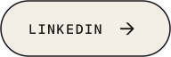</picture></a>&nbsp;<a href="https://twitter.com/hamzaisadev"><picture><source media="(prefers-color-scheme: dark)" srcset="https://raw.githubusercontent.com/Hamzaisadev/Hamzaisadev/main/assets/nav-x-dark.svg" /><source media="(prefers-color-scheme: light)" srcset="https://raw.githubusercontent.com/Hamzaisadev/Hamzaisadev/main/assets/nav-x-light.svg" />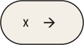</picture></a>&nbsp;<a href="https://youtube.com/channel/UCPR0FgOTackPp82nMyPqf5A"><picture><source media="(prefers-color-scheme: dark)" srcset="https://raw.githubusercontent.com/Hamzaisadev/Hamzaisadev/main/assets/nav-youtube-dark.svg" /><source media="(prefers-color-scheme: light)" srcset="https://raw.githubusercontent.com/Hamzaisadev/Hamzaisadev/main/assets/nav-youtube-light.svg" />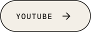</picture></a>&nbsp;<a href="mailto:hamzaisadev@gmail.com"><picture><source media="(prefers-color-scheme: dark)" srcset="https://raw.githubusercontent.com/Hamzaisadev/Hamzaisadev/main/assets/nav-email-dark.svg" /><source media="(prefers-color-scheme: light)" srcset="https://raw.githubusercontent.com/Hamzaisadev/Hamzaisadev/main/assets/nav-email-light.svg" />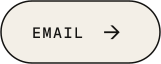</picture></a></p>


</div>

<br />

<picture>
  <source media="(prefers-color-scheme: dark)" srcset="https://raw.githubusercontent.com/Hamzaisadev/Hamzaisadev/main/assets/monogram-dark.gif" />
  <source media="(prefers-color-scheme: light)" srcset="https://raw.githubusercontent.com/Hamzaisadev/Hamzaisadev/main/assets/monogram-light.gif" />
  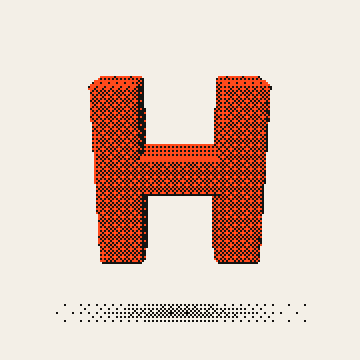
</picture>

### Hi, I'm Hamza.

I'm a full-stack developer in Karachi and the founder of **Albatix**, where I build websites and online stores for businesses that need a site that sells, not just a site that exists.

I judge my work by whether it brings in more customers, sales or profit, not by how much code I wrote. I use AI heavily, but I still need to understand the code well enough to direct it, check it and debug it.

Mostly **Next.js, React and TypeScript**, backed by **Postgres or Supabase**. I'm open to **front-end roles** (Karachi or remote) and to **freelance builds**.

<br clear="right" />
<br />

<picture>
  <source media="(prefers-color-scheme: dark)" srcset="https://raw.githubusercontent.com/Hamzaisadev/Hamzaisadev/main/assets/h01-dark.svg" />
  <source media="(prefers-color-scheme: light)" srcset="https://raw.githubusercontent.com/Hamzaisadev/Hamzaisadev/main/assets/h01-light.svg" />
  
</picture>

<a href="https://curewell-ai.vercel.app">
<picture>
  <source media="(prefers-color-scheme: dark)" srcset="https://raw.githubusercontent.com/Hamzaisadev/Hamzaisadev/main/assets/card-curewell-dark.svg" />
  <source media="(prefers-color-scheme: light)" srcset="https://raw.githubusercontent.com/Hamzaisadev/Hamzaisadev/main/assets/card-curewell-light.svg" />
  
</picture>
</a>

<p align="center"><a href="https://curewell-ai.vercel.app"><b>Live ↗</b></a>&nbsp;&nbsp;·&nbsp;&nbsp;<a href="https://github.com/Hamzaisadev/Curewell"><b>Source</b></a></p>

<a href="https://gadi-ghar.vercel.app">
<picture>
  <source media="(prefers-color-scheme: dark)" srcset="https://raw.githubusercontent.com/Hamzaisadev/Hamzaisadev/main/assets/card-gadighar-dark.svg" />
  <source media="(prefers-color-scheme: light)" srcset="https://raw.githubusercontent.com/Hamzaisadev/Hamzaisadev/main/assets/card-gadighar-light.svg" />
  
</picture>
</a>

<p align="center"><a href="https://gadi-ghar.vercel.app"><b>Live ↗</b></a>&nbsp;&nbsp;·&nbsp;&nbsp;<a href="https://github.com/Hamzaisadev/gadi-ghar"><b>Source</b></a></p>

<a href="https://snapistan.vercel.app">
<picture>
  <source media="(prefers-color-scheme: dark)" srcset="https://raw.githubusercontent.com/Hamzaisadev/Hamzaisadev/main/assets/card-snapistan-dark.svg" />
  <source media="(prefers-color-scheme: light)" srcset="https://raw.githubusercontent.com/Hamzaisadev/Hamzaisadev/main/assets/card-snapistan-light.svg" />
  
</picture>
</a>

<p align="center"><a href="https://snapistan.vercel.app"><b>Live ↗</b></a>&nbsp;&nbsp;·&nbsp;&nbsp;<a href="https://github.com/Hamzaisadev/Snapistan"><b>Source</b></a></p>

<p align="center"><sub><b>CLIENT WEBSITES</b> · designed and built through Albatix, my studio</sub></p>

<table>
  <tr>
    <td width="50%" valign="top">
<a href="https://al-muzzammil.vercel.app">
<picture>
  <source media="(prefers-color-scheme: dark)" srcset="https://raw.githubusercontent.com/Hamzaisadev/Hamzaisadev/main/assets/card-almuzzammil-dark.svg" />
  <source media="(prefers-color-scheme: light)" srcset="https://raw.githubusercontent.com/Hamzaisadev/Hamzaisadev/main/assets/card-almuzzammil-light.svg" />
  
</picture>
</a>
<p align="center"><a href="https://al-muzzammil.vercel.app"><b>Visit site ↗</b></a></p>
    </td>
    <td width="50%" valign="top">
<a href="https://79st-auto-website.vercel.app">
<picture>
  <source media="(prefers-color-scheme: dark)" srcset="https://raw.githubusercontent.com/Hamzaisadev/Hamzaisadev/main/assets/card-79stauto-dark.svg" />
  <source media="(prefers-color-scheme: light)" srcset="https://raw.githubusercontent.com/Hamzaisadev/Hamzaisadev/main/assets/card-79stauto-light.svg" />
  
</picture>
</a>
<p align="center"><a href="https://79st-auto-website.vercel.app"><b>Visit site ↗</b></a></p>
    </td>
  </tr>
</table>

<details>
<summary><b>From the archive</b> — older and smaller builds</summary>
<br />

| Project | What it is | Stack | Links |
| :-- | :-- | :-- | :-- |
| **PennyWise** | Personal budgeting with expense breakdowns | React, React Router | [Live](https://pennywisse.netlify.app/) · [Repo](https://github.com/Hamzaisadev/PennyWise) |
| **Vidiyo** | Video discovery and sharing | React, REST APIs | [Live](https://vidiyoo.netlify.app) · [Repo](https://github.com/Hamzaisadev/Vidiyo) |
| **SmartPress** | WordPress plugin that compresses images and serves modern formats | PHP, WordPress | [Repo](https://github.com/Hamzaisadev/smartpress-image-optimizer) |
| **Sabrina** | A chat-style AI assistant | JavaScript | [Repo](https://github.com/Hamzaisadev/Sabrina-Ai-Assistant) |
| **JavaScript Lab** | Small vanilla JS apps, one concept each | HTML, CSS, JS | [Live](https://hamzaisadev.github.io/Java-Script-Projects/) · [Repo](https://github.com/Hamzaisadev/Java-Script-Projects) |
| **Riwayat** | Men's traditional clothing store | Next.js, Tailwind | [Portfolio](https://hamzaisadev.netlify.app) |
| **Shoeaholic** | Footwear store with SEO-first product structure | Next.js | [Portfolio](https://hamzaisadev.netlify.app) |

</details>

<br />

<picture>
  <source media="(prefers-color-scheme: dark)" srcset="https://raw.githubusercontent.com/Hamzaisadev/Hamzaisadev/main/assets/h02-dark.svg" />
  <source media="(prefers-color-scheme: light)" srcset="https://raw.githubusercontent.com/Hamzaisadev/Hamzaisadev/main/assets/h02-light.svg" />
  
</picture>

<picture>
  <source media="(prefers-color-scheme: dark)" srcset="https://raw.githubusercontent.com/Hamzaisadev/Hamzaisadev/main/assets/now-dark.svg" />
  <source media="(prefers-color-scheme: light)" srcset="https://raw.githubusercontent.com/Hamzaisadev/Hamzaisadev/main/assets/now-light.svg" />
  
</picture>

<picture>
  <source media="(prefers-color-scheme: dark)" srcset="https://raw.githubusercontent.com/Hamzaisadev/Hamzaisadev/main/assets/live-commit-dark.svg" />
  <source media="(prefers-color-scheme: light)" srcset="https://raw.githubusercontent.com/Hamzaisadev/Hamzaisadev/main/assets/live-commit-light.svg" />
  
</picture>

<picture>
  <source media="(prefers-color-scheme: dark)" srcset="https://raw.githubusercontent.com/Hamzaisadev/Hamzaisadev/main/assets/live-shipped-dark.svg" />
  <source media="(prefers-color-scheme: light)" srcset="https://raw.githubusercontent.com/Hamzaisadev/Hamzaisadev/main/assets/live-shipped-light.svg" />
  
</picture>

<br />

<picture>
  <source media="(prefers-color-scheme: dark)" srcset="https://raw.githubusercontent.com/Hamzaisadev/Hamzaisadev/main/assets/h03-dark.svg" />
  <source media="(prefers-color-scheme: light)" srcset="https://raw.githubusercontent.com/Hamzaisadev/Hamzaisadev/main/assets/h03-light.svg" />
  
</picture>

<picture>
  <source media="(prefers-color-scheme: dark)" srcset="https://raw.githubusercontent.com/Hamzaisadev/Hamzaisadev/main/assets/toolbox-dark.svg" />
  <source media="(prefers-color-scheme: light)" srcset="https://raw.githubusercontent.com/Hamzaisadev/Hamzaisadev/main/assets/toolbox-light.svg" />
  
</picture>

<br />

<picture>
  <source media="(prefers-color-scheme: dark)" srcset="https://raw.githubusercontent.com/Hamzaisadev/Hamzaisadev/main/assets/h04-dark.svg" />
  <source media="(prefers-color-scheme: light)" srcset="https://raw.githubusercontent.com/Hamzaisadev/Hamzaisadev/main/assets/h04-light.svg" />
  
</picture>

<div align="center">

<picture>
  <source media="(prefers-color-scheme: dark)" srcset="https://raw.githubusercontent.com/Hamzaisadev/Hamzaisadev/main/assets/pulse-dark.svg" />
  <source media="(prefers-color-scheme: light)" srcset="https://raw.githubusercontent.com/Hamzaisadev/Hamzaisadev/main/assets/pulse-light.svg" />
  
</picture>

<br /><br />

<picture>
  <source media="(prefers-color-scheme: dark)" srcset="https://raw.githubusercontent.com/Hamzaisadev/Hamzaisadev/output/snake-dark.svg" />
  <source media="(prefers-color-scheme: light)" srcset="https://raw.githubusercontent.com/Hamzaisadev/Hamzaisadev/output/snake-light.svg" />
  
</picture>

<br /><br />

<picture>
  <source media="(prefers-color-scheme: dark)" srcset="https://raw.githubusercontent.com/Hamzaisadev/Hamzaisadev/main/assets/live-visitors-dark.svg" />
  <source media="(prefers-color-scheme: light)" srcset="https://raw.githubusercontent.com/Hamzaisadev/Hamzaisadev/main/assets/live-visitors-light.svg" />
  
</picture>

</div>

<details>
<summary><b>WakaTime</b> — hours, languages and editors, updated daily</summary>
<br />

<!--START_SECTION:waka-->


**🐱 My GitHub Data** 

> 📦 412.2 kB Used in GitHub's Storage 
 > 
> 🏆 264 Contributions in the Year 2026
 > 
> 🚫 Not Opted to Hire
 > 
> 📜 48 Public Repositories 
 > 
> 🔑 11 Private Repositories 
 > 
**I'm an Early 🐤** 

```text
🌞 Morning                973 commits         █████████░░░░░░░░░░░░░░░░   36.84 % 
🌆 Daytime                732 commits         ███████░░░░░░░░░░░░░░░░░░   27.72 % 
🌃 Evening                576 commits         █████░░░░░░░░░░░░░░░░░░░░   21.81 % 
🌙 Night                  360 commits         ███░░░░░░░░░░░░░░░░░░░░░░   13.63 % 
```
📅 **I'm Most Productive on Thursday** 

```text
Monday                   100 commits         █░░░░░░░░░░░░░░░░░░░░░░░░   03.79 % 
Tuesday                  74 commits          █░░░░░░░░░░░░░░░░░░░░░░░░   02.80 % 
Wednesday                272 commits         ███░░░░░░░░░░░░░░░░░░░░░░   10.30 % 
Thursday                 1249 commits        ████████████░░░░░░░░░░░░░   47.29 % 
Friday                   592 commits         ██████░░░░░░░░░░░░░░░░░░░   22.42 % 
Saturday                 184 commits         ██░░░░░░░░░░░░░░░░░░░░░░░   06.97 % 
Sunday                   170 commits         ██░░░░░░░░░░░░░░░░░░░░░░░   06.44 % 
```


📊 **This Week I Spent My Time On** 

```text
🕑︎ Time Zone: Asia/Karachi

💬 Programming Languages: 
TypeScript               5 hrs 30 mins       ████████████░░░░░░░░░░░░░   48.27 % 
Other                    1 hr 46 mins        ████░░░░░░░░░░░░░░░░░░░░░   15.52 % 
JavaScript               1 hr 22 mins        ███░░░░░░░░░░░░░░░░░░░░░░   12.00 % 
CSS                      1 hr 10 mins        ███░░░░░░░░░░░░░░░░░░░░░░   10.29 % 
Markdown                 1 hr 5 mins         ██░░░░░░░░░░░░░░░░░░░░░░░   09.57 % 

🔥 Editors: 
Claude Code              10 hrs 10 mins      ██████████████████████░░░   89.23 % 
VS Code                  52 mins             ██░░░░░░░░░░░░░░░░░░░░░░░   07.60 % 
Antigravity Desktop      21 mins             █░░░░░░░░░░░░░░░░░░░░░░░░   03.17 % 

🐱‍💻 Projects: 
AnyRef                   4 hrs 38 mins       ██████████░░░░░░░░░░░░░░░   40.65 % 
Medfolio v2              3 hrs 23 mins       ███████░░░░░░░░░░░░░░░░░░   29.74 % 
Stash                    2 hrs 59 mins       ███████░░░░░░░░░░░░░░░░░░   26.26 % 
Unknown Project          22 mins             █░░░░░░░░░░░░░░░░░░░░░░░░   03.34 % 

💻 Operating System: 
Windows                  11 hrs 24 mins      █████████████████████████   100.00 % 
```

🤖 **AI Coding This Week** 

```text
⏱ AI Coding Time: 11 hrs 22 mins (99.74%)

✍️ 17,655 lines written by AI, 1 lines written by hand (99.99% AI-written)

🔤 7,259,004 Input Tokens, 1,067,493 Output Tokens

💵 $282.06 Estimated AI Cost This Week

🧠 28 AI Sessions, 63 AI Prompts

Opus                     18,165 lines        █████████████████████████   100.00 % 
Gemini                   0 lines             ░░░░░░░░░░░░░░░░░░░░░░░░░   00.00 % 
M                        0 lines             ░░░░░░░░░░░░░░░░░░░░░░░░░   00.00 % 

🔎 AI Coding Insights:
🤖 AI-Driven — 99.99% of written lines came from AI
📚 Verbose Prompter — average 1,685 characters per prompt
🔁 Iterative Prompter — average 2 prompts per session
🚀 High AI Trust — 0.01% of changed lines were hand-edited
```

**I Mostly Code in JavaScript** 

```text
JavaScript               21 repos            ██████████░░░░░░░░░░░░░░░   38.18 % 
Python                   11 repos            █████░░░░░░░░░░░░░░░░░░░░   20.00 % 
TypeScript               10 repos            █████░░░░░░░░░░░░░░░░░░░░   18.18 % 
C                        2 repos             █░░░░░░░░░░░░░░░░░░░░░░░░   03.64 % 
PHP                      1 repo              ░░░░░░░░░░░░░░░░░░░░░░░░░   01.82 % 
```


**Timeline**


 Last Updated on 10/11/2026 05:22:42 UTC
<!--END_SECTION:waka-->

</details>

<br />

<picture>
  <source media="(prefers-color-scheme: dark)" srcset="https://raw.githubusercontent.com/Hamzaisadev/Hamzaisadev/main/assets/h05-dark.svg" />
  <source media="(prefers-color-scheme: light)" srcset="https://raw.githubusercontent.com/Hamzaisadev/Hamzaisadev/main/assets/h05-light.svg" />
  
</picture>

<picture>
  <source media="(prefers-color-scheme: dark)" srcset="https://raw.githubusercontent.com/Hamzaisadev/Hamzaisadev/main/assets/work-dark.svg" />
  <source media="(prefers-color-scheme: light)" srcset="https://raw.githubusercontent.com/Hamzaisadev/Hamzaisadev/main/assets/work-light.svg" />
  
</picture>

<p align="center"><a href="https://github.com/Hamzaisadev/Hamzaisadev/issues/new?template=start-a-project.yml"><picture><source media="(prefers-color-scheme: dark)" srcset="https://raw.githubusercontent.com/Hamzaisadev/Hamzaisadev/main/assets/btn-project-dark.svg" /><source media="(prefers-color-scheme: light)" srcset="https://raw.githubusercontent.com/Hamzaisadev/Hamzaisadev/main/assets/btn-project-light.svg" /></picture></a>&nbsp;&nbsp;<a href="mailto:hamzaisadev@gmail.com?subject=Front-end%20role%20%E2%80%94%20CV%20request"><picture><source media="(prefers-color-scheme: dark)" srcset="https://raw.githubusercontent.com/Hamzaisadev/Hamzaisadev/main/assets/btn-cv-dark.svg" /><source media="(prefers-color-scheme: light)" srcset="https://raw.githubusercontent.com/Hamzaisadev/Hamzaisadev/main/assets/btn-cv-light.svg" />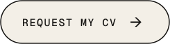</picture></a></p>

<p align="center"><sub>“Start a project” opens a short brief form here on GitHub: goal, pages, budget and timeline. Prefer private? Email works too.</sub></p>

<br />

<picture>
  <source media="(prefers-color-scheme: dark)" srcset="https://raw.githubusercontent.com/Hamzaisadev/Hamzaisadev/main/assets/h06-dark.svg" />
  <source media="(prefers-color-scheme: light)" srcset="https://raw.githubusercontent.com/Hamzaisadev/Hamzaisadev/main/assets/h06-light.svg" />
  
</picture>

<picture>
  <source media="(prefers-color-scheme: dark)" srcset="https://raw.githubusercontent.com/Hamzaisadev/Hamzaisadev/main/assets/live-guestbook-dark.svg" />
  <source media="(prefers-color-scheme: light)" srcset="https://raw.githubusercontent.com/Hamzaisadev/Hamzaisadev/main/assets/live-guestbook-light.svg" />
  
</picture>

<p align="center"><a href="https://github.com/Hamzaisadev/Hamzaisadev/issues/new?template=guestbook.yml"><picture><source media="(prefers-color-scheme: dark)" srcset="https://raw.githubusercontent.com/Hamzaisadev/Hamzaisadev/main/assets/btn-sign-dark.svg" /><source media="(prefers-color-scheme: light)" srcset="https://raw.githubusercontent.com/Hamzaisadev/Hamzaisadev/main/assets/btn-sign-light.svg" /></picture></a></p>

<br />

<picture>
  <source media="(prefers-color-scheme: dark)" srcset="https://raw.githubusercontent.com/Hamzaisadev/Hamzaisadev/main/assets/live-poll-dark.svg" />
  <source media="(prefers-color-scheme: light)" srcset="https://raw.githubusercontent.com/Hamzaisadev/Hamzaisadev/main/assets/live-poll-light.svg" />
  
</picture>

<p align="center"><a href="https://github.com/Hamzaisadev/Hamzaisadev/issues/new?template=vote.yml"><picture><source media="(prefers-color-scheme: dark)" srcset="https://raw.githubusercontent.com/Hamzaisadev/Hamzaisadev/main/assets/btn-vote-dark.svg" /><source media="(prefers-color-scheme: light)" srcset="https://raw.githubusercontent.com/Hamzaisadev/Hamzaisadev/main/assets/btn-vote-light.svg" />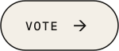</picture></a></p>

<br />

<h3 align="center">Ask me anything</h3>

<!--AMA:START-->
> **Q · [@Hamzaisadev](https://github.com/Hamzaisadev):** HOW DID YOU MADE THIS
>
> Using claude
>
> <sub>[Thread ↗](https://github.com/Hamzaisadev/Hamzaisadev/issues/2)</sub>
<!--AMA:END-->

<p align="center"><a href="https://github.com/Hamzaisadev/Hamzaisadev/issues/new?template=ama.yml"><picture><source media="(prefers-color-scheme: dark)" srcset="https://raw.githubusercontent.com/Hamzaisadev/Hamzaisadev/main/assets/btn-ama-dark.svg" /><source media="(prefers-color-scheme: light)" srcset="https://raw.githubusercontent.com/Hamzaisadev/Hamzaisadev/main/assets/btn-ama-light.svg" />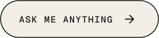</picture></a></p>

<p align="center"><sub>Signing, voting and asking open a short GitHub form. Press submit, and a GitHub Action updates this page within a couple of minutes.</sub></p>

<br />

<a href="mailto:hamzaisadev@gmail.com">
<picture>
  <source media="(prefers-color-scheme: dark)" srcset="https://raw.githubusercontent.com/Hamzaisadev/Hamzaisadev/main/assets/footer-dark.svg" />
  <source media="(prefers-color-scheme: light)" srcset="https://raw.githubusercontent.com/Hamzaisadev/Hamzaisadev/main/assets/footer-light.svg" />
  
</picture>
</a>

<p align="center"><sub><a href="./docs/HOW-IT-WORKS.md">How this README redraws itself →</a></sub></p>


