<!-- Profile README for @Hamzaisadev. Every image in /assets is generated (see /assets/README.md). -->

<div align="center">

<a href="https://hamzaisadev.netlify.app">
<picture>
  <source media="(prefers-color-scheme: dark)" srcset="./assets/hero-dark.svg" />
  <source media="(prefers-color-scheme: light)" srcset="./assets/hero-light.svg" />
  
</picture>
</a>

<br />

<a href="https://hamzaisadev.netlify.app"><b>Portfolio</b></a>&nbsp;&nbsp;·&nbsp;&nbsp;<a href="https://www.linkedin.com/in/hamzaisadev/"><b>LinkedIn</b></a>&nbsp;&nbsp;·&nbsp;&nbsp;<a href="https://twitter.com/hamzaisadev"><b>X</b></a>&nbsp;&nbsp;·&nbsp;&nbsp;<a href="https://youtube.com/channel/UCPR0FgOTackPp82nMyPqf5A"><b>YouTube</b></a>&nbsp;&nbsp;·&nbsp;&nbsp;<a href="mailto:hamzaisadev@gmail.com"><b>Email</b></a>

</div>

<br />

<picture>
  <source media="(prefers-color-scheme: dark)" srcset="./assets/monogram-dark.gif" />
  <source media="(prefers-color-scheme: light)" srcset="./assets/monogram-light.gif" />
  
</picture>

### Hi, I'm Hamza.

I'm a full-stack developer in Karachi and the founder of **Albatix**, where I build websites and online stores for businesses that need a site that sells, not just a site that exists.

I judge my work by whether it brings in more customers, sales or profit, not by how much code I wrote. I use AI heavily, but I still need to understand the code well enough to direct it, check it and debug it.

Mostly **Next.js, React and TypeScript**, backed by **Postgres or Supabase**. I'm open to **front-end roles** (Karachi or remote) and to **freelance builds**.

<br clear="right" />
<br />

<picture>
  <source media="(prefers-color-scheme: dark)" srcset="./assets/h01-dark.svg" />
  <source media="(prefers-color-scheme: light)" srcset="./assets/h01-light.svg" />
  
</picture>

<a href="https://curewell-gamma.vercel.app">
<picture>
  <source media="(prefers-color-scheme: dark)" srcset="./assets/card-curewell-dark.svg" />
  <source media="(prefers-color-scheme: light)" srcset="./assets/card-curewell-light.svg" />
  
</picture>
</a>

<p align="center"><a href="https://curewell-gamma.vercel.app"><b>Live ↗</b></a>&nbsp;&nbsp;·&nbsp;&nbsp;<a href="https://github.com/Hamzaisadev/Curewell"><b>Source</b></a></p>

<a href="https://stash-ed.vercel.app">
<picture>
  <source media="(prefers-color-scheme: dark)" srcset="./assets/card-stash-dark.svg" />
  <source media="(prefers-color-scheme: light)" srcset="./assets/card-stash-light.svg" />
  
</picture>
</a>

<p align="center"><a href="https://stash-ed.vercel.app"><b>Live ↗</b></a>&nbsp;&nbsp;·&nbsp;&nbsp;<a href="https://github.com/Hamzaisadev/Stash"><b>Source</b></a></p>

<a href="https://gadi-ghar.vercel.app">
<picture>
  <source media="(prefers-color-scheme: dark)" srcset="./assets/card-gadighar-dark.svg" />
  <source media="(prefers-color-scheme: light)" srcset="./assets/card-gadighar-light.svg" />
  
</picture>
</a>

<p align="center"><a href="https://gadi-ghar.vercel.app"><b>Live ↗</b></a>&nbsp;&nbsp;·&nbsp;&nbsp;<a href="https://github.com/Hamzaisadev/gadi-ghar"><b>Source</b></a></p>

<table>
  <tr>
    <td width="50%" valign="top">
<a href="https://snapistan.vercel.app">
<picture>
  <source media="(prefers-color-scheme: dark)" srcset="./assets/card-snapistan-dark.svg" />
  <source media="(prefers-color-scheme: light)" srcset="./assets/card-snapistan-light.svg" />
  
</picture>
</a>
<p align="center"><a href="https://snapistan.vercel.app"><b>Live ↗</b></a>&nbsp;&nbsp;·&nbsp;&nbsp;<a href="https://github.com/Hamzaisadev/Snapistan"><b>Source</b></a></p>
    </td>
    <td width="50%" valign="top">
<a href="https://github.com/Hamzaisadev/DevShot">
<picture>
  <source media="(prefers-color-scheme: dark)" srcset="./assets/card-devshot-dark.svg" />
  <source media="(prefers-color-scheme: light)" srcset="./assets/card-devshot-light.svg" />
  
</picture>
</a>
<p align="center"><a href="https://github.com/Hamzaisadev/DevShot"><b>Source</b></a>&nbsp;&nbsp;·&nbsp;&nbsp;<a href="https://codeload.github.com/Hamzaisadev/DevShot/zip/refs/heads/main"><b>Download zip</b></a></p>
    </td>
  </tr>
  <tr>
    <td width="50%" valign="top">
<a href="https://linkwhize.netlify.app/">
<picture>
  <source media="(prefers-color-scheme: dark)" srcset="./assets/card-linkwhiz-dark.svg" />
  <source media="(prefers-color-scheme: light)" srcset="./assets/card-linkwhiz-light.svg" />
  
</picture>
</a>
<p align="center"><a href="https://linkwhize.netlify.app/"><b>Live ↗</b></a>&nbsp;&nbsp;·&nbsp;&nbsp;<a href="https://github.com/Hamzaisadev/LinkWhiz"><b>Source</b></a></p>
    </td>
    <td width="50%" valign="top">
<a href="https://github.com/Hamzaisadev/daily-dev-vault">
<picture>
  <source media="(prefers-color-scheme: dark)" srcset="./assets/card-vault-dark.svg" />
  <source media="(prefers-color-scheme: light)" srcset="./assets/card-vault-light.svg" />
  
</picture>
</a>
<p align="center"><a href="https://github.com/Hamzaisadev/daily-dev-vault"><b>Read the vault</b></a></p>
    </td>
  </tr>
</table>

<details>
<summary><b>From the archive</b> — older and smaller builds</summary>
<br />

| Project | What it is | Stack | Links |
| :-- | :-- | :-- | :-- |
| **PennyWise** | Personal budgeting with expense breakdowns | React, React Router | [Live](https://pennywisse.netlify.app/) · [Repo](https://github.com/Hamzaisadev/PennyWise) |
| **Vidiyo** | Video discovery and sharing | React, REST APIs | [Live](https://vidiyoo.netlify.app) · [Repo](https://github.com/Hamzaisadev/Vidiyo) |
| **SmartPress** | WordPress plugin that compresses images and serves modern formats | PHP, WordPress | [Repo](https://github.com/Hamzaisadev/smartpress-image-optimizer) |
| **Sabrina** | A chat-style AI assistant | JavaScript | [Repo](https://github.com/Hamzaisadev/Sabrina-Ai-Assistant) |
| **JavaScript Lab** | Small vanilla JS apps, one concept each | HTML, CSS, JS | [Live](https://hamzaisadev.github.io/Java-Script-Projects/) · [Repo](https://github.com/Hamzaisadev/Java-Script-Projects) |
| **Riwayat** | Men's traditional clothing store | Next.js, Tailwind | [Portfolio](https://hamzaisadev.netlify.app) |
| **Shoeaholic** | Footwear store with SEO-first product structure | Next.js | [Portfolio](https://hamzaisadev.netlify.app) |

</details>

<br />

<picture>
  <source media="(prefers-color-scheme: dark)" srcset="./assets/h02-dark.svg" />
  <source media="(prefers-color-scheme: light)" srcset="./assets/h02-light.svg" />
  
</picture>

<picture>
  <source media="(prefers-color-scheme: dark)" srcset="./assets/now-dark.svg" />
  <source media="(prefers-color-scheme: light)" srcset="./assets/now-light.svg" />
  
</picture>

<br />

<picture>
  <source media="(prefers-color-scheme: dark)" srcset="./assets/h03-dark.svg" />
  <source media="(prefers-color-scheme: light)" srcset="./assets/h03-light.svg" />
  
</picture>

<picture>
  <source media="(prefers-color-scheme: dark)" srcset="./assets/toolbox-dark.svg" />
  <source media="(prefers-color-scheme: light)" srcset="./assets/toolbox-light.svg" />
  
</picture>

<br />

<picture>
  <source media="(prefers-color-scheme: dark)" srcset="./assets/h04-dark.svg" />
  <source media="(prefers-color-scheme: light)" srcset="./assets/h04-light.svg" />
  
</picture>

<div align="center">

<picture>
  <source media="(prefers-color-scheme: dark)" srcset="https://raw.githubusercontent.com/Hamzaisadev/Hamzaisadev/output/snake-dark.svg" />
  <source media="(prefers-color-scheme: light)" srcset="https://raw.githubusercontent.com/Hamzaisadev/Hamzaisadev/output/snake-light.svg" />
  
</picture>

<br /><br />

<a href="https://git.io/streak-stats">
<picture>
  <source media="(prefers-color-scheme: dark)" srcset="https://streak-stats.demolab.com?user=Hamzaisadev&hide_border=true&border_radius=0&background=0E0E0D&ring=FF5A2E&fire=FF5A2E&currStreakNum=EEE9DF&sideNums=EEE9DF&currStreakLabel=FF5A2E&sideLabels=8D877C&dates=8D877C&stroke=2B2926" />
  <source media="(prefers-color-scheme: light)" srcset="https://streak-stats.demolab.com?user=Hamzaisadev&hide_border=true&border_radius=0&background=F3EFE7&ring=FF4A1C&fire=FF4A1C&currStreakNum=141311&sideNums=141311&currStreakLabel=FF4A1C&sideLabels=6E685E&dates=6E685E&stroke=D6CFC2" />
  
</picture>
</a>

</div>

<details>
<summary><b>WakaTime</b> — hours, languages and editors, updated daily</summary>
<br />

<!--START_SECTION:waka-->


**🐱 My GitHub Data** 

> 📦 402.0 kB Used in GitHub's Storage 
 > 
> 🏆 230 Contributions in the Year 2026
 > 
> 🚫 Not Opted to Hire
 > 
> 📜 42 Public Repositories 
 > 
> 🔑 11 Private Repositories 
 > 
**I'm an Early 🐤** 

```text
🌞 Morning                912 commits         █████████░░░░░░░░░░░░░░░░   36.89 % 
🌆 Daytime                656 commits         ███████░░░░░░░░░░░░░░░░░░   26.54 % 
🌃 Evening                560 commits         ██████░░░░░░░░░░░░░░░░░░░   22.65 % 
🌙 Night                  344 commits         ███░░░░░░░░░░░░░░░░░░░░░░   13.92 % 
```
📅 **I'm Most Productive on Thursday** 

```text
Monday                   93 commits          █░░░░░░░░░░░░░░░░░░░░░░░░   03.76 % 
Tuesday                  68 commits          █░░░░░░░░░░░░░░░░░░░░░░░░   02.75 % 
Wednesday                272 commits         ███░░░░░░░░░░░░░░░░░░░░░░   11.00 % 
Thursday                 1173 commits        ████████████░░░░░░░░░░░░░   47.45 % 
Friday                   535 commits         █████░░░░░░░░░░░░░░░░░░░░   21.64 % 
Saturday                 184 commits         ██░░░░░░░░░░░░░░░░░░░░░░░   07.44 % 
Sunday                   147 commits         █░░░░░░░░░░░░░░░░░░░░░░░░   05.95 % 
```


📊 **This Week I Spent My Time On** 

```text
🕑︎ Time Zone: Asia/Karachi

💬 Programming Languages: 
TypeScript               1 hr 40 mins        ██████████████░░░░░░░░░░░   55.35 % 
Other                    1 hr 1 min          ████████░░░░░░░░░░░░░░░░░   33.84 % 
JavaScript               9 mins              █░░░░░░░░░░░░░░░░░░░░░░░░   05.30 % 
Markdown                 8 mins              █░░░░░░░░░░░░░░░░░░░░░░░░   04.50 % 
SQL                      1 min               ░░░░░░░░░░░░░░░░░░░░░░░░░   00.61 % 

🔥 Editors: 
Claude Code              1 hr 58 mins        ████████████████░░░░░░░░░   65.60 % 
VS Code                  40 mins             ██████░░░░░░░░░░░░░░░░░░░   22.41 % 
Antigravity Desktop      21 mins             ███░░░░░░░░░░░░░░░░░░░░░░   11.99 % 

🐱‍💻 Projects: 
Medfolio v2              1 hr 44 mins        ██████████████░░░░░░░░░░░   57.80 % 
AnyRef                   44 mins             ██████░░░░░░░░░░░░░░░░░░░   24.76 % 
Stash                    18 mins             ███░░░░░░░░░░░░░░░░░░░░░░   10.10 % 
Unknown Project          13 mins             ██░░░░░░░░░░░░░░░░░░░░░░░   07.35 % 

💻 Operating System: 
Windows                  3 hrs               █████████████████████████   100.00 % 
```

🤖 **AI Coding This Week** 

```text
⏱ AI Coding Time: 3 hrs (100.0%)

✍️ 6,337 lines written by AI, 0 lines written by hand (100.0% AI-written)

🔤 2,236,187 Input Tokens, 332,650 Output Tokens

💵 $41.22 Estimated AI Cost This Week

🧠 17 AI Sessions, 25 AI Prompts

Opus                     6,412 lines         █████████████████████████   100.00 % 
Gemini                   0 lines             ░░░░░░░░░░░░░░░░░░░░░░░░░   00.00 % 
M                        0 lines             ░░░░░░░░░░░░░░░░░░░░░░░░░   00.00 % 

🔎 AI Coding Insights:
🤖 AI-Driven — 100.0% of written lines came from AI
📄 Detailed Prompter — average 747 characters per prompt
🎯 One-Shot Prompter — average 1 prompts per session
🚀 High AI Trust — 0.0% of changed lines were hand-edited
```

**I Mostly Code in JavaScript** 

```text
JavaScript               20 repos            ██████████░░░░░░░░░░░░░░░   40.82 % 
Python                   10 repos            █████░░░░░░░░░░░░░░░░░░░░   20.41 % 
TypeScript               6 repos             ███░░░░░░░░░░░░░░░░░░░░░░   12.24 % 
C                        2 repos             █░░░░░░░░░░░░░░░░░░░░░░░░   04.08 % 
PHP                      1 repo              █░░░░░░░░░░░░░░░░░░░░░░░░   02.04 % 
```


**Timeline**


 Last Updated on 08/11/2026 03:31:28 UTC
<!--END_SECTION:waka-->

</details>

<br />

<picture>
  <source media="(prefers-color-scheme: dark)" srcset="./assets/h05-dark.svg" />
  <source media="(prefers-color-scheme: light)" srcset="./assets/h05-light.svg" />
  
</picture>

<picture>
  <source media="(prefers-color-scheme: dark)" srcset="./assets/work-dark.svg" />
  <source media="(prefers-color-scheme: light)" srcset="./assets/work-light.svg" />
  
</picture>

<p align="center">
<a href="https://github.com/Hamzaisadev/Hamzaisadev/issues/new?template=start-a-project.yml">
<picture>
  <source media="(prefers-color-scheme: dark)" srcset="./assets/btn-project-dark.svg" />
  
</picture>
</a>
&nbsp;&nbsp;
<a href="mailto:hamzaisadev@gmail.com?subject=Front-end%20role%20%E2%80%94%20CV%20request">
<picture>
  <source media="(prefers-color-scheme: dark)" srcset="./assets/btn-cv-dark.svg" />
  
</picture>
</a>
</p>

<p align="center"><sub>“Start a project” opens a short brief form here on GitHub: goal, pages, budget and timeline. Prefer private? Email works too.</sub></p>

<br />

<a href="mailto:hamzaisadev@gmail.com">
<picture>
  <source media="(prefers-color-scheme: dark)" srcset="./assets/footer-dark.svg" />
  <source media="(prefers-color-scheme: light)" srcset="./assets/footer-light.svg" />
  
</picture>
</a>
